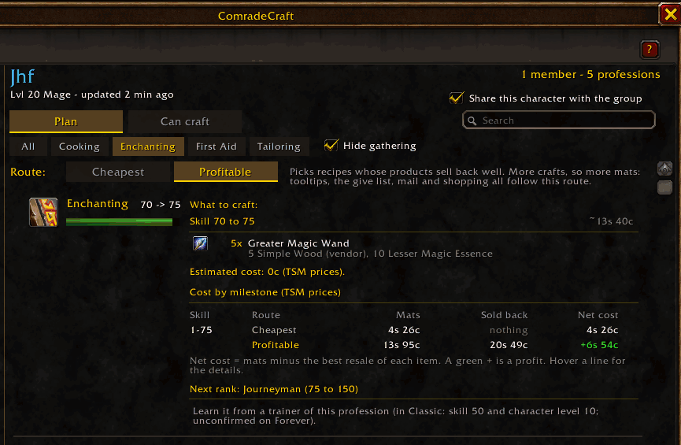
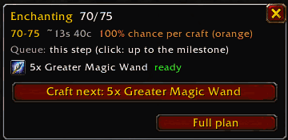

  

  <em>Level your professions together.</em> 
  Profession leveling for WoW Forever, built for groups of friends. It answers one question:
  <strong>what should I do with what I have, for the group?</strong>

  
  
  
  

---

ComradeCraft plans the cheapest (or most profitable) way to level every crafting profession
on WoW Forever, from the materials in your bags and live auction prices, and shares it with
your friends so the whole group levels faster and spends less gold. Everything is one click
away from its minimap button.

## Sound familiar?

- You sell Light Leather on the auction house, and your friend buys it back an hour later.
- Your leveling guide says "craft 20 of X", but you already have materials for something cheaper.
- You craft hundreds of items that sell for less than their materials.
- You leave the game to look up where a recipe is taught or which quest unlocks Artisan.
- Your friend logs off before you can ask them to craft something for you.
- You forget profession cooldowns on your alts.

  

## Features

**Plan your route**
- **Personal leveling route**: recipes to learn, intermediates to craft, the skill-up chance
  of each step, and the total cost, from your bags, your known recipes and live prices.
- **Cheapest or Profitable**: Profitable counts what each product brings back (merchant,
  disenchant or auction house after the 5% cut and the deposit risk). Cost and net cost for
  every 75-point milestone.
- **Step panel and craft queue** next to the profession window, with a *Craft next* button.
- **Where to learn a recipe**: trainers, vendors and drops, with a TomTom waypoint to the
  nearest one. Trainers you visit are remembered with their exact position.
- **Next rank**: at the skill cap, the Expert book, the Artisan quest (with Questie) or the
  trainer.
- **Shopping lists**: export the missing materials to Auctionator, or copy a search text and a
  group import for TradeSkillMaster.

**Play as a group**
- **Group plan**: by default, routes spend the least gold for the whole group (materials a
  member already holds count as free). One view shows what the group still needs, who holds
  spare stock, and what is left to buy.
- **Farming assignments** (opt-in): "200 Light Leather needed for X, Y, Z. Farm them?" Accept
  and a small tracker follows your progress; the group sees who farms what.
- **Group material tooltip**: on any item, who needs it, how many, and how soon.
- **Keep for the group**: at a merchant or the auction house, the items in your bags that
  your group needs. Sell one anyway and a *Buy back* button appears.
- **Craft requests**: ask a friend to craft a recipe for you. The request waits until you
  are both online.
- **Mail helper**: attaches what a group member needs. You still press Send.

**Stay on top of things**
- **Alerts**, each one can be turned off: materials ready, cooldowns ready on any of your
  characters, craft requests, and (opt-in) upgrades a friend can craft for you.
- **Disenchant or keep**: advice for the items in your bags, from group needs and prices.

  

## Get started in 3 clicks

1. Click the **ComradeCraft minimap button**. A short tour shows the basics.
2. In **Manage group**, check the characters you want to share.
3. Add your friends by name, or accept the guildmates the addon suggests. Both players add
   each other.

Open a profession window and the step panel appears next to it. Playing alone? The route,
step panel, shopping lists and alerts work without a group.

## Works with your addons

Nothing else is required; the libraries it uses are embedded (see
[THIRD_PARTY.md](THIRD_PARTY.md)). ComradeCraft detects these optional addons:

| Addon | What it adds | Without it |
|---|---|---|
| [TradeSkillMaster](https://www.curseforge.com/wow/addons/tradeskill-master) | Auction prices, disenchant value, shopping search text and group import (TSM has no API to edit groups, so ComradeCraft tells you which ones are done) | Auctionator, else merchant prices |
| [Auctionator](https://www.curseforge.com/wow/addons/auctionator) | Auction prices, disenchant value, shopping list export | No export (the list is still shown) |
| Questie (with QuestieDB) | Positions of trainers, vendors and drops; the Artisan quest and its giver | Names only; no Artisan quest |
| [TomTom](https://www.curseforge.com/wow/addons/tomtom) | Waypoints to the nearest recipe source or quest giver | Location printed in chat |
| [Pawn](https://www.curseforge.com/wow/addons/pawn) | Upgrades with each member's class and spec scale (called at runtime, no scale copied) | Item level comparison |

When TSM and Auctionator are both loaded, prices come from TSM.

## FAQ

**Which game version?** WoW Forever, client 1.60.1 (Interface 16001).

**Which professions?** Alchemy, Blacksmithing, Cooking, Enchanting, Engineering, First Aid,
Leatherworking and Tailoring get leveling routes. Fishing, Mining, Herbalism and Skinning are
tracked for group needs.

**Do my friends need the addon?** Yes, to share their needs, farm for the group and receive
craft requests. Your own route works without them.

**Is my data sent to anyone?** No character data leaves your game until you share a
character, and then only by addon whisper to the players you added who added you back. At
login, a presence signal without character data goes to your guild's addon channel so
guildmates can find each other; it can be turned off in Manage group.

**Where do the skill-up chances come from?** The Classic formula, calibrated with the crafts
you and your group log. Recipe colors and reagents come from the WoW Forever client tables.

**Languages?** English, French, German, Spanish (Spain and Mexico), Italian, Brazilian
Portuguese and Russian, following your game language. French is reviewed; the others are
machine translations, corrections welcome.

<strong>Chat commands</strong> (every one also has a button in the window)

| Command | Effect |
|---|---|
| `/comrade` | Open the group window |
| `/comrade shop [profession]` | List the mats to buy and export them |
| `/comrade tracker [reset]` | Show or hide the step panel; `reset` docks it back |
| `/comrade mail NAME` | At a mailbox: attach what NAME needs |
| `/comrade share [off]` | Share this character with your group |
| `/comrade add NAME` / `remove NAME` | Add or remove a player |
| `/comrade peers` / `sync` | List the players seen / send your data now |
| `/comrade guildping [off]` | Tell the guild you use ComradeCraft |
| `/comrade needs` / `stats` | Print your route / the measured skill-up rates |
| `/comrade scan` / `api` / `audit` / `log clear` | Diagnostics |

## Early version

Not yet verified in game: craft requests and farming assignments between two players, the
Artisan quests from Questie (assumed to require 225 in the skill, as in Classic), Questie
positions and TomTom waypoints, the TSM search text and group import, the Auctionator export,
Pawn's scale names on Forever, and the mail helper next to other mail addons. Bug reports and
ideas are welcome in the [issues](https://github.com/JF10R/comradeCraft/issues).

## For developers

- Addon code: `ComradeCraft/` (load order in `ComradeCraft.toc`). Translations: `Locale.lua`
  (frFR) and `Locales/*.lua`.
- Offline tests: `python -X utf8 tools/check_lua.py` (needs `lupa`). They run the addon in a
  mocked client and check every translation for missing keys and format specifiers.
- Releases: push a `v*` tag; the GitHub workflow packages the addon and uploads it to
  CurseForge (see [docs/RELEASE.md](docs/RELEASE.md)).

## License

MIT, see [LICENSE](LICENSE). Embedded libraries keep their own licenses.
