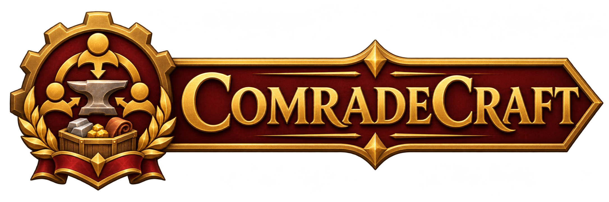

  

  <em>Level your professions together.</em> 
  A WoW Forever addon for groups of friends. It answers one question:
  <strong>what should I do with what I have, for the group?</strong>

  
  
  
  

---

## Features

- **Item tooltip**: who in your group needs this material, how many, and how soon.
- **Group window** (`/comrade`): each character's leveling route (recipes to learn at the
  trainer, intermediates to craft, skill-up chances, costs), what they can craft, the most
  wanted materials, what you can give to whom, and what to disenchant or keep.
- **Step panel**: next to the profession window, the current step, its skill-up chance,
  how many crafts your bags allow, and the next step.
- **Mail helper**: attaches what a group member needs. It never sends the mail for you.
- **Craft requests**: click a recipe in a group member's Can craft tab to ask for it; they
  accept, craft and mark it done. Delivered the next time you are both online.
- **Alerts** (each can be turned off): mats ready for your next craft, profession cooldowns
  ready on any of your characters, craft requests, and (opt-in) upgrades a group member can
  craft for you, with a button to ask for it.
- **Next rank**: at the skill cap, how to get the next one: the Expert book of Cooking,
  First Aid and Fishing (vendor or auction house), the Artisan quest found in Questie, or the
  trainer for primary professions.
- **Sharing** with the friends and guildmates you add, opt-in per character.

English, French, German, Spanish (Spain and Mexico), Italian, Brazilian Portuguese and
Russian (follows the game's language). French is reviewed; the others are machine
translations, corrections welcome.

---

## Requirements

- WoW Forever (client 1.60.1, Interface 16001).
- No other addon is required. The libraries it uses are embedded; see
  [THIRD_PARTY.md](THIRD_PARTY.md) for the list and their licenses.

## Recommended addons

All optional. ComradeCraft detects them when the game loads.

| Addon | What it adds | Without it |
|---|---|---|
| [TradeSkillMaster](https://www.curseforge.com/wow/addons/tradeskill-master) | Auction prices (DBMarket) for step costs and route choice; disenchant value (Destroy) for "sell or disenchant" advice; **Shopping list** button gives a search text for TSM's Shopping tab and a group to import (`ComradeCraft > Character > Tailoring 80-125`); TSM has no API to create, change or delete groups, so ComradeCraft tells you which ones are done or replaced | Auctionator, else merchant prices |
| [Auctionator](https://www.curseforge.com/wow/addons/auctionator) | Auction prices when TSM is absent; **Shopping list** button exports a plan's missing mats as an Auctionator list; disenchant value | No shopping list export (`/comrade shop` still prints the list) |
| Questie (with its QuestieDB) | Positions of the trainers, vendors and mobs that give a recipe you must learn; the Artisan quest of Cooking, First Aid and Fishing and who starts it | Names only (from the embedded recipe data); no Artisan quest |
| [TomTom](https://www.curseforge.com/wow/addons/tomtom) | Click a "Learn ..." step: waypoint to the nearest source | Location printed in chat |
| [Pawn](https://www.curseforge.com/wow/addons/pawn) | Upgrade detection with the class and specialization scale of each group member | Item level comparison |

Notes:

- When TSM and Auctionator are both loaded, prices come from TSM.
- Trainers you talk to are remembered with their exact position and come first in "Learn"
  waypoints (the embedded lists are capped at 12 trainers per recipe).
- Pawn is called while the game runs; none of its scales are copied (its license forbids it).
- Mail addons (Postal, TSM's mail tab, ...): the mail button sits outside the send-mail
  frame so it does not cover them. If an addon replaces that frame, click an entry of
  "You can give" in the group window while the mailbox is open, or type `/comrade mail NAME`.

Not yet verified in game: craft requests between two players (sync and mail), the craft
queue's Craft next, Questie positions and TomTom waypoints, the Artisan quests from Questie (assumed to require
225 in the skill, as in Classic), the TSM search text and group
import, Pawn's scale names on Forever, the Auctionator export, the TSM and Auctionator
disenchant values, and the mail helper next to other mail addons.

---

## Commands

| Command | Effect |
|---|---|
| `/comrade` | Open the group window |
| `/comrade shop [profession]` | List the mats to buy; export them to Auctionator and/or show TSM's search text |
| `/comrade tracker [reset]` | Show/hide the step panel; `reset` docks it back next to the profession window |
| `/comrade mail NAME` | At a mailbox: attach what NAME needs |
| `/comrade share [off]` | Share this character with your group (off by default) |
| `/comrade add NAME` / `remove NAME` | Add or remove a player (both sides must add each other) |
| `/comrade peers` / `sync` | List the players seen / send your data now |
| `/comrade guildping [off]` | Tell the guild you use ComradeCraft (a presence signal only) |
| `/comrade needs` / `stats` | Print your route / the measured skill-up rates |
| `/comrade scan` / `api` / `audit` / `log clear` | Diagnostics |

---

## Privacy

No character data is sent until you share a character. Data then goes by addon whisper,
only to the players you added and who added you back. At login, a presence signal (no
character data) goes to your guild's addon channel so guildmates with ComradeCraft can be
suggested; `/comrade guildping off` turns it off.

## Data

Recipe colors and reagents come from the WoW Forever client tables (published by
wago.tools). Skill-up chances start from the Classic formula and are calibrated with the
crafts you and your group log. Disenchant yields are estimates until enough real
disenchants are logged.

---

## License

MIT, see [LICENSE](LICENSE). Embedded libraries keep their own licenses.
