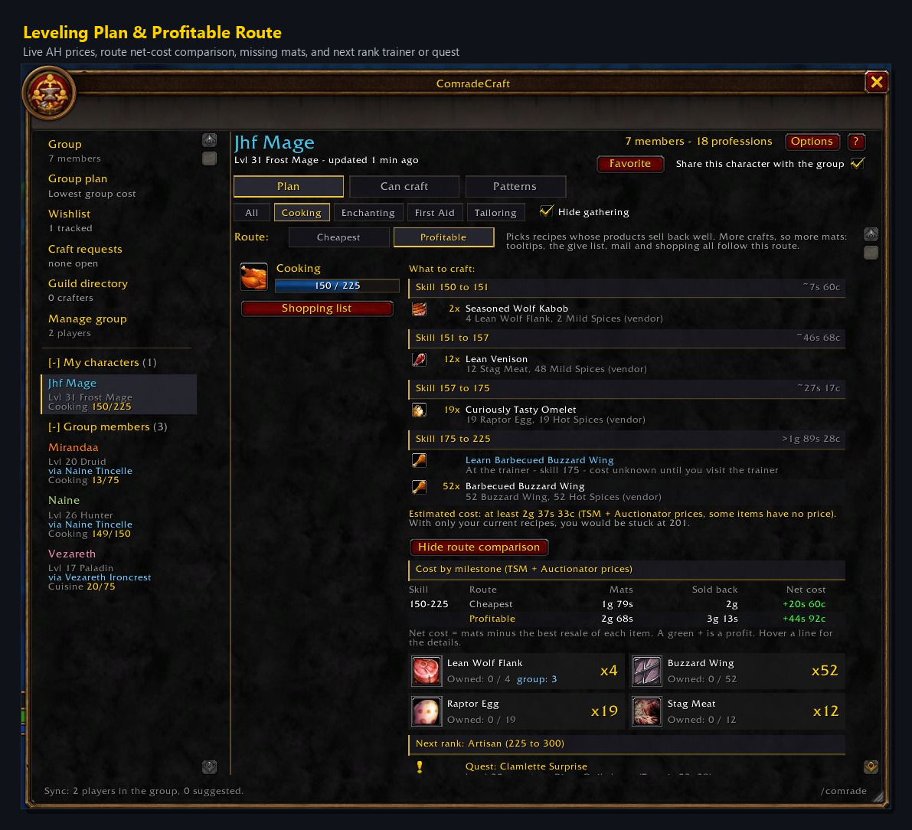
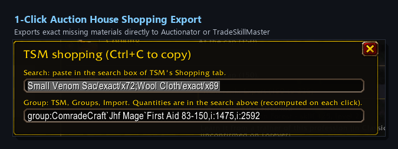
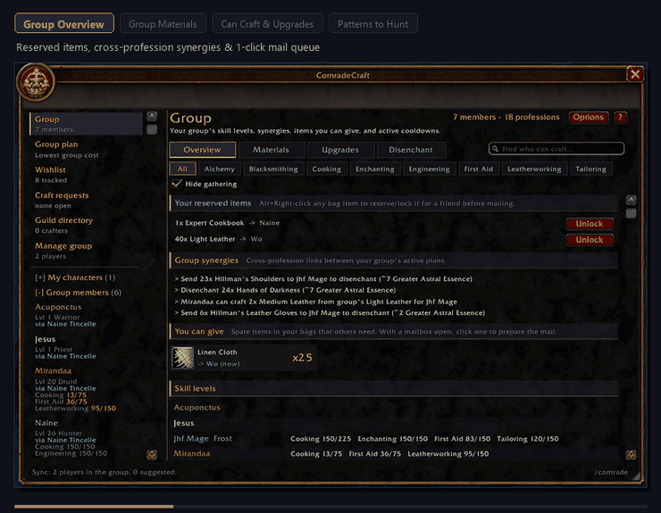
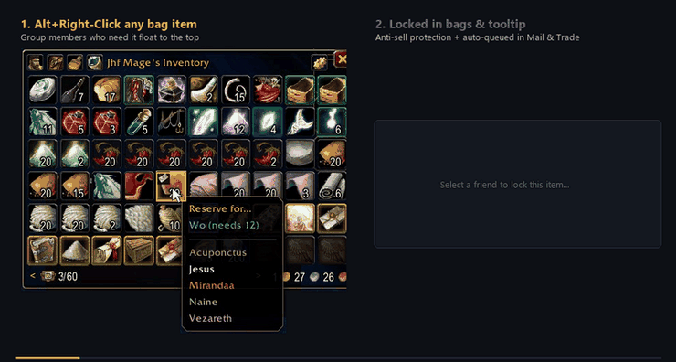
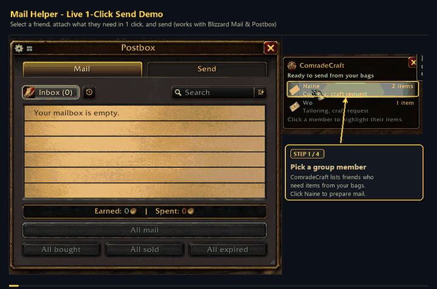
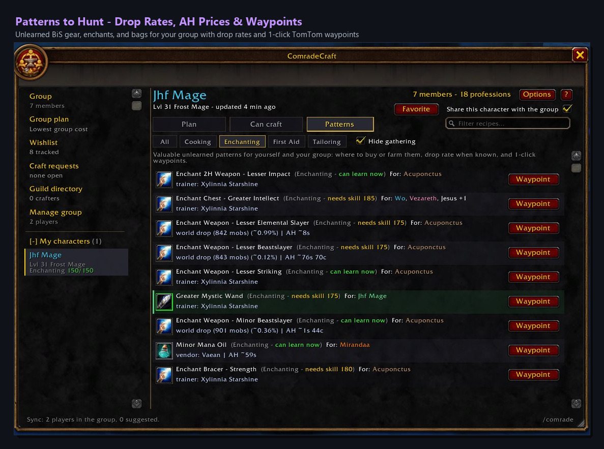
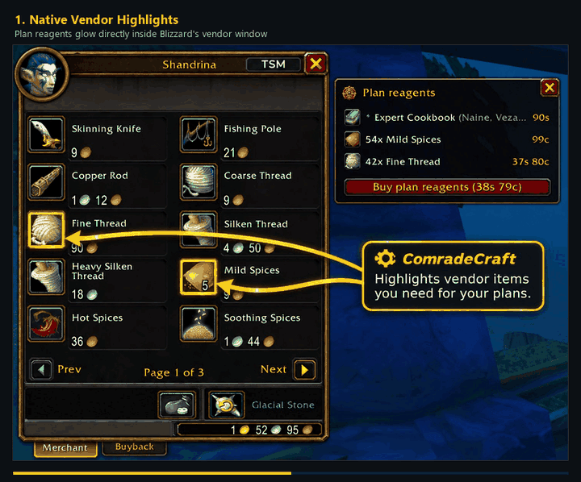
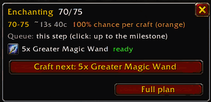

  

<h3 align="center">The Co-Op Profession &amp; Craftable BiS Brain for WoW Forever</h3>

  <strong>Stop vendoring mats your friends are about to buy. Stop alt-tabbing for static guides.</strong> 
  ComradeCraft connects your alts, friends, and guild into one live crafting economy. <strong>100% in-game, zero spreadsheets, zero external servers</strong> (and works standalone solo too).

  
  
  
  

---

## Why ComradeCraft?

Static guides don't know what's in your bags. Economy addons don't coordinate your friends. **ComradeCraft bridges both**: every route, bag highlight, tooltip, bank withdraw, and mail attachment thinks across your entire group.

| The Problem | How ComradeCraft Fixes It |
|---|---|
| You AH or vendor Silk Cloth, and your friend buys it an hour later | **Bag highlights, Keep alerts & 1-click Mail / Trade / Bank helpers** |
| Static guides waste gold ignoring mats already in your group | **Live Cheapest / Profitable routes** using group stock + live AH prices |
| Alt-tabbing for Expert/Artisan trainers, drops, or craftable BiS | **All 12 Expert/Artisan trainers (Alliance & Horde) + Standalone BiS Engine (9 classes, 29 specs)** |
| Friends play at different hours or switch alts constantly | **100% in-game Mesh Sync + Guild Channel Sync + Shared Bank Alts** |
| Juggling Lesser & Greater enchanting essences by hand | **Automatic 3x Lesser <-> 1x Greater conversion** across plans, mail & bags |

  

---

## Key Features

### 1. Dynamic Leveling & Economy
- **Cheapest vs Profitable routes**: Live cost per 75-point milestone, factoring vendor sell, disenchant value, and AH resale (after 5% cut & deposit risk).
- **Zero-waste Essence Conversions**: Automatic `3x Lesser <-> 1x Greater` math across plans, surplus, mail, bags, and right-click conversion hints.
- **All 12 Expert (150 to 225) & Artisan (225 to 300) Trainers**: Built-in Alliance & Horde trainers, rank-unlock books (Cooking, First Aid, Fishing), and Artisan quests with QuestieDB + TomTom waypoints.
- **1-Click Shopping Export**: Instant Auctionator shopping lists or copy-ready TSM exact search strings & groups.

  

### 2. Co-Op Group Brain & Shared Bank Alts
- **Mesh Sync & Guild Channel Sync**: Mutually added peers automatically relay up-to-date snapshots for offline friends, keeping everyone synced across timezones with zero external apps.
- **Shared Bank Alts**: Flag any alt as a *Shared bank alt* so 100% of its bags, bank, and mail appear as available group stock, searchable with **1-click item requests**.
- **Item Reservations (`Alt+Right-Click`)**: Lock and tag bag items for a specific friend with a violet lock badge, anti-sell warning, 1-click Bank & Mail queuing, and live sync so they see `"Reserved for you"` before you even hit Send.
- **Bag Highlights, Auto-Sort Categories & Tooltips**: Crisp borders & mailbox badges light up spare mats, reserved items, unknown non-BoP patterns, and request reagents in your bags, focusing in gold on your active Mail or Trade target, plus native **`ComradeCraft` categories** in Baganator and BetterBags.
- **Craft Requests, Shared Wishlist & Farming Banner**: Request crafts or bank items, pin shared goals in an on-screen tracker, see a live **"Farming for you"** banner on `Group -> Overview`, and share missing mats to `/g` or `/p` in 1 click.
- **Favorites, Guild Directory & 100+ Guild Scaling**: Star favorite players and preferred crafters to pin them at the top of the Sidebar & Guild Directory (and prioritize them in `Upgrades`), quick-filter large rosters, search `/comrade directory`, and get live dungeon loot roll hints.

  

  

  

### 3. Standalone Craftable BiS Engine & Patterns to Hunt (9 Classes, 29 Specs)
- **Auto-detects specs** from talents & spells (with 1-click UI / `/comrade spec` override), with zero external addon required.
- **Top 5 craftable upgrades per slot** across yourself (incl. BoP), alts, friends, and guild directory, with 2H vs 1H+OH math, wands, 180+ combat enchants, `+1-4 lvl` upcoming BiS, and spec consumables.
- **Dedicated `Patterns` Tab**: Lists high-value unlearned gear, enchanting formulas, bigger bags, and consumables for yourself and your group, complete with **where to buy or farm, drop rates (358 Classic recipes + optional Forever Drops/Lootified connector), BoE AH prices, 1-click TomTom waypoints**, and **1-click BoE pattern AH search**.

  

### 4. Companion Panels Everywhere You Click
- **Mailbox** (Blizzard, Postbox, Postal, ElvUI, TSM): 1-click attach for mats, patterns & requests, bank-only warnings, and WoW Forever First+Last name safety.
- **Bank**: 1-click **Withdraw needed** for your current step, Wishlist, or queued group mail.
- **Merchant**: Highlights plan reagents and learnable rank books/recipes **directly in Blizzard's vendor window**, plus a side panel to buy exact missing quantities or buried Page 3 books (like *Expert Cookbook* for a friend) in 1 click.
- **Auction House**: 1-click search for missing mats and **BoE BiS patterns** with gold balance summary.
- **Trainer & Trade**: Trainer BiS/plan highlighter and 1-click trade fill.
- **Craft Queue**: Docked step panel beside your profession window with a **Craft next** button.

  

  

---

## Get Started in 30 Seconds

1. Click the **ComradeCraft minimap button** (or type `/comrade`).
2. Open **Manage group**, check characters to share (and optionally flag a **Shared bank alt**).
3. Add friends by name or click **Add** on guildmates/party members. *(Playing solo? Every route, BiS audit, shopping list, and companion panel works out of the box.)*

---

## Compatible & Recommended Addons

**Zero dependencies required**: ComradeCraft works 100% standalone with Blizzard's default UI and bundles every needed library. Installing any of the addons below unlocks extra integrations automatically:

| Category | Compatible / Complementary Addons | Integration |
|---|---|---|
| **Economy & AH** *(Recommended)* | **TradeSkillMaster (TSM)**, **Auctionator** | Live AH prices, disenchant values, 1-click Auctionator shopping lists, copy-ready TSM exact search & group imports, and 1-click BoE BiS pattern search |
| **Bags & Bank** | **Blizzard Bags**, **Bagnon**, **BagBrother**, **Combuctor**, **Baganator**, **BetterBags**, **ElvUI**, **EllesmereUI**, **ArkInventory** | Native in-bag borders, violet lock & mailbox badges, Mail/Trade focus dimming, `Alt+Right-Click` item reservations, Bank quick-withdraw docking, plus native **`ComradeCraft` auto-sort category** in **Baganator** & **BetterBags** |
| **Mailbox** | **Blizzard Mail**, **Postbox**, **Postal**, **ElvUI**, **TSM Mailing** | Seamless mailbox side-panel docking, live recipient focus, 1-click attach, and WoW Forever `"First Last"` name resolution (`Postbox` recipient history supported) |
| **Map, Waypoints & Drops** | **TomTom**, **Questie**, **Forever Drops**, **Lootified** | 1-click TomTom map arrows, exact Questie NPC/vendor/mob coordinates (with built-in fallback coords for all 34 Expert/Artisan trainers), and optional live server drop rates on top of the built-in 358 Classic recipe drop table |
| **Gear & DataText Bars** | **Pawn**, **Titan Panel**, **Bazooka**, **ChocolateBar**, **ElvUI DataTexts** | Optional custom Pawn stat-weight fallback (fast standalone 9-class / 29-spec BiS engine built in) and live LibDataBroker counter + Blizzard Addon Compartment support |

---

## Privacy, Performance & Languages

- **Privacy-First**: Nothing leaves your client until you opt in. Full records go only by addon whisper to mutually added friends; Guild Directory shares only professions & recipes.
- **Built for Zero Lag**: Fast C-API stat scoring, combat-deferred refreshes (`PLAYER_REGEN_ENABLED`), diffed bag scans, and per-frame overlay caching.
- **Native WoW Integration**: Blizzard Options panel (`Esc -> Options -> AddOns`), customizable UI scale & resizable height, native Keybinding (`Bindings.xml`), Addon Compartment + LibDataBroker DataText (TitanPanel/Bazooka/ElvUI), rarity borders, and subtle sound notifications.
- **Native WoW Forever 1.60.1**: Full two-part `"First Last"` name support with auto-migration and active live recipe difficulty calibration.
- **7 Languages**: English, French, German, Spanish, Italian, Brazilian Portuguese, and Russian.

<strong>Chat Commands</strong> (every action also has a UI button)

| Command | Action |
|---|---|
| `/comrade` | Open the ComradeCraft window |
| `/comrade spec [name]` | View or override your character's BiS spec |
| `/comrade shop [profession]` | Export missing mats to Auctionator or TSM |
| `/comrade tracker [reset]` | Toggle or re-dock the step panel |
| `/comrade mail NAME` | Prepare mail attachments for a group member |
| `/comrade reserve [ITEM] NAME [QTY]` | Lock/reserve a bag item for a friend (or `Alt+Right-Click` in bags) |
| `/comrade share [on\|off\|all\|none]` | Toggle character sharing |
| `/comrade list [off]` / `directory [text]` | Opt into or search the guild crafter directory |
| `/comrade add NAME` / `remove NAME` | Add or remove a player |
| `/comrade peers` / `sync` | View peers or force a sync now |
| `/comrade needs` / `stats` / `audit` | Print leveling route, calibration, or BiS audit |

---

## For Developers & Feedback

- Built & actively maintained for **WoW Forever 1.60.1** (Interface `16001`). Bug reports & ideas welcome in [GitHub Issues](https://github.com/JF10R/comradeCraft/issues).
- Offline verification suite: `python tools/check_lua.py` (syntax, 6-locale parity, 18 unit test suites).
- License: **MIT** ([LICENSE](LICENSE), embedded libraries in [THIRD_PARTY.md](THIRD_PARTY.md)).
